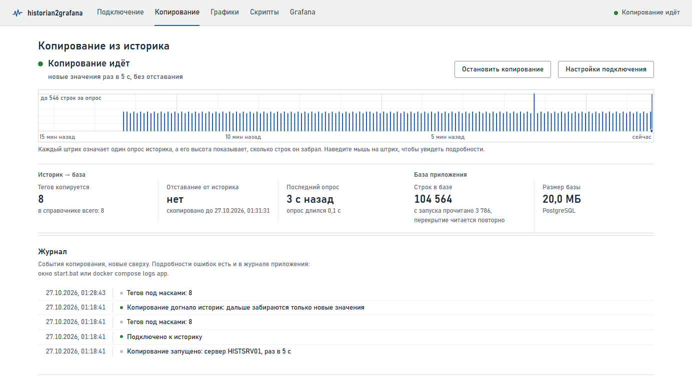

# historian2grafana

Приложение раз в несколько секунд забирает значения тегов из AVEVA Historian, складывает их в
свою базу данных и строит по ней графики: на своей странице и в Grafana. Сам историк оно только
читает.



## Что умеет

- Подключается к AVEVA Historian через его SQL Server (база `Runtime`) логином SQL Server или
  учётной записью Windows.
- Выбирает теги по маскам из таблицы `Runtime.dbo.Tag`, например `Line1_*, Mixer_*`, кроме
  `Sys*`. Новые теги, подходящие под маски, подхватывает само.
- Проверяет подключение по шагам: вход, список тегов, чтение значений. Заодно оценивает, сколько
  строк в сутки придётся хранить.
- Копирует раз в 5 секунд. При первом запуске загружает историю за заданное число часов, дальше
  берёт только новые значения. Дублей не бывает, а пропущенное после перерыва докопируется само.
- Рисует графики. На один график можно положить несколько тегов, у каждой единицы измерения своя
  шкала, масштаб меняется мышью и по времени, и по значениям. Данные выгружаются в CSV. Для
  Grafana есть готовый дашборд «Теги историка».
- Выполняет скрипты по скопированным данным: находит пики, участки выше порога, считает время над
  порогом, разности и связи тегов (корреляцию, линейную модель). Результат можно положить на
  график рядом с тегами. Если вы раньше не программировали, начните с
  [руководства для начинающих](docs/SCRIPTS.md). Оно же есть в Word (`docs/Скрипты.docx`) и
  открывается прямо в приложении со страницы «Скрипты».

Изменения по версиям описаны в [CHANGES.md](CHANGES.md).

## Два способа установки

| | Комплект без Docker | Docker Desktop |
|---|---|---|
| Когда подходит | Компьютер без интернета, виртуальная машина, нет прав администратора | Компьютер с интернетом, Docker Desktop уже стоит |
| Что ставить на целевой компьютер | Ничего: одна папка, запуск `start.bat` | Docker Desktop (и WSL 2) |
| Права администратора | Не нужны | Нужны для установки Docker Desktop |
| Вход в историк учётной записью Windows | Как в SSMS, без пароля, если компьютер в домене | Только с логином `ДОМЕН\логин` и паролем |
| База данных | PostgreSQL 16 | PostgreSQL 16 + TimescaleDB (сжимает старые данные) |
| Инструкция | [ниже](#установка-на-компьютер-без-интернета) | [docs/INSTALL.md](docs/INSTALL.md) |

Страницы приложения, копирование и дашборд Grafana в обоих случаях одинаковые.

---

## Установка на компьютер без интернета

Этот способ подходит для виртуальной машины или любого компьютера с Windows без интернета, если
на него можно перенести файлы: через общую папку, буфер обмена удалённого рабочего стола или
флешку.

### Нужен ли Docker Desktop?

Нет. Без интернета с Docker Desktop больше всего хлопот:

- внутри виртуальной машины ему нужна вложенная виртуализация (WSL 2 внутри VM). Включает её
  администратор гипервизора, и на корпоративных виртуальных машинах она часто выключена;
- без интернета придётся отдельно ставить WSL 2 и сам Docker Desktop, а образы переносить
  командами `docker save` и `docker load`;
- крупной компании для работы с Docker Desktop нужна платная подписка.

Поэтому на компьютере с интернетом собирается комплект: одна папка, в которой уже лежат Python,
PostgreSQL, Grafana и само приложение. На виртуалке её достаточно распаковать и запустить
`start.bat`. В Windows ничего не устанавливается, права администратора не нужны. Чтобы удалить
приложение, сотрите папку.

### Что понадобится

| Где | Что |
|---|---|
| Компьютер с интернетом | Windows 10/11, PowerShell (есть в Windows), около 2 ГБ свободного места, эта папка проекта |
| Виртуалка без интернета | Windows 10/11 64-бит, около 2 ГБ свободного места плюс место под данные, сетевой доступ к серверу историка (TCP-порт 1433) |
| Учётная запись историка | Логин SQL Server с правом чтения базы `Runtime` или доменная учётная запись Windows, под которой вы входите в SSMS |

### Шаг 1. Собрать комплект (на компьютере с интернетом)

Откройте PowerShell в папке проекта (в Проводнике: адресная строка, `powershell`, Enter) и
выполните:

```powershell
powershell -ExecutionPolicy Bypass -File offline\build-offline.ps1
```

Сценарий скачает около 600 МБ и через 5–15 минут соберёт архив
`dist\historian2grafana-offline.zip` размером около 250 МБ. Внутри:

| Папка или файл | Что это |
|---|---|
| `start.bat` | Запуск базы, Grafana и приложения |
| `stop.bat` | Остановка базы и Grafana |
| `check.bat` | Проверка связи с сервером историка |
| `.env.example` | Порты и пароли (при первом запуске копируется в `.env`) |
| `runtime\python` | Python 3.13 без установки, со всеми библиотеками приложения |
| `runtime\pgsql` | PostgreSQL 16 без установки |
| `runtime\grafana` | Grafana 11.6 без установки |
| `app`, `web`, `grafana`, `docker` | Само приложение, страницы, дашборд Grafana, настройки драйвера |

Если интернет идёт через прокси и сценарий не может ничего скачать, скачайте три архива
браузером в папку `dist\downloads`, не меняя имён, и запустите сценарий снова. Скачанное он
возьмёт оттуда.

| Файл | Откуда |
|---|---|
| `python-3.13.16-embed-amd64.zip` | https://www.python.org/ftp/python/3.13.16/python-3.13.16-embed-amd64.zip |
| `postgresql-16.15-1-windows-x64-binaries.zip` | https://get.enterprisedb.com/postgresql/postgresql-16.15-1-windows-x64-binaries.zip |
| `grafana-11.6.0.windows-amd64.zip` | https://dl.grafana.com/oss/release/grafana-11.6.0.windows-amd64.zip |

Библиотеки Python сценарий всё равно скачивает сам с pypi.org, так что доступ в интернет из
PowerShell нужен.

### Шаг 2. Перенести на виртуалку

1. Скопируйте на виртуалку один файл, `historian2grafana-offline.zip`.
2. Распакуйте его в корень любого диска, где хватает места: `C:\`, `D:\` или `E:\`. Правый щелчок
   по архиву, «Извлечь все…», укажите, например, `D:\`. Получится папка
   `D:\historian2grafana-offline`. Дальше в инструкции она называется папкой комплекта.

> **Важно.** Диск подойдёт любой, но путь должен быть коротким и без русских букв, лучше прямо в
> корне диска. У Grafana много файлов с длинными именами, и из глубокой папки Windows их не
> распакует. PostgreSQL, в свою очередь, не любит русские буквы в пути к данным. К конкретному
> диску комплект не привязан: все пути он считает от папки, где лежит `start.bat`.

### Шаг 3. Запустить

Дважды щёлкните `start.bat` в папке комплекта. В первый раз около 10 секунд уйдёт на создание
базы данных, потом запустятся PostgreSQL, Grafana и приложение, и откроется браузер на
http://localhost:8000. В окне будет примерно такой текст:

```
historian2grafana 1.1.2 — запуск

  Первый запуск: создаю базу данных в папке data\postgres…
  Запускаю PostgreSQL (порт 55432)…
  Запускаю Grafana (порт 3000)…

  Приложение:  http://localhost:8000
  Grafana:     http://localhost:3000

  Не закрывайте это окно, пока работаете. Остановить: Ctrl+C.
```

- Пока приложение нужно, окно не закрывайте. Закрыли окно, и копирование остановилось.
- Grafana в первый раз запускается до минуты. Если http://localhost:3000 сразу не открылся,
  подождите и обновите страницу.
- Если Windows спросит про брандмауэр для `python.exe` или `grafana.exe`, разрешайте доступ только
  тогда, когда страницы будут открывать с других компьютеров. Для работы на самой виртуалке можно
  нажать «Отмена».
- Если появится синее окно «Windows защитила ваш компьютер», нажмите «Подробнее», затем
  «Выполнить в любом случае».

### Шаг 4. Проверить сеть до историка

Прежде чем вводить настройки, убедитесь, что виртуалка видит сервер историка. Откройте командную
строку в папке комплекта (адресная строка Проводника, `cmd`, Enter) и выполните команду, подставив
имя или IP-адрес своего сервера вместо HISTSRV01:

```bat
check.bat HISTSRV01 1433
```

В ответе должны быть строки `✓ адрес …` и `✓ открыт`. Если имя не находится, попробуйте полное имя
с доменом или IP-адрес: их покажет `nslookup HISTSRV01` или подскажет администратор. Если порт
закрыт, историк с виртуалки по сети недоступен, и нужно открывать доступ в брандмауэре.

### Шаг 5. Подключиться к историку

На странице «Подключение» (http://localhost:8000):

1. В поле «Сервер историка» укажите то же имя, что в SSMS (`HISTSRV01`), полное имя или IP-адрес.
   Порт оставьте пустым (будет 1433), база — `Runtime`.
2. Выберите способ входа:

   | Ситуация | Что выбрать и заполнить |
   |---|---|
   | Виртуалка в домене, и вы вошли в Windows той же учётной записью, что в SSMS | «Учётная запись Windows», логин и пароль оставьте пустыми. Приложение войдёт под вами, как SSMS с «Windows Authentication» |
   | Виртуалка не в домене (или вы вошли в неё другой учётной записью) | «Учётная запись Windows», логин `CORP\ваш_логин` и пароль от него |
   | Есть отдельный логин SQL Server | «Логин SQL Server», логин и пароль |

3. В «Какие теги копировать» для первой проверки хватит нескольких масок, например `Line1_*`.
   Если оставить поле пустым, скопируются все теги, кроме `Sys*`. В «Загрузить историю за
   последние» поставьте, например, 24 часа.
4. Нажмите «Проверить подключение». Все три шага должны стать зелёными.
5. Нажмите «Сохранить и начать копирование». Откроется страница «Копирование».

Графики смотрите на странице «Графики» или в Grafana на http://localhost:3000: дашборд «Теги
историка» открывается сразу, входить не нужно. Пики и пороги отбирают на странице «Скрипты».
Подробнее о страницах, скриптах, Grafana и о том, как сверить данные с SSMS, написано в
[docs/INSTALL.md](docs/INSTALL.md), разделы 7–10.

> Вход без пароля работает только потому, что приложение запущено под вашей учётной записью
> Windows. Если `start.bat` запустит другой пользователь, в историк войдёт он.

### Повседневная работа

| Задача | Как |
|---|---|
| Запустить | `start.bat` |
| Остановить приложение | Ctrl+C в окне `start.bat` (на вопрос «Завершить выполнение пакетного файла?» ответьте `Y`) или просто закрыть окно |
| Остановить и базу, и Grafana | `stop.bat`. После закрытия окна они работают в фоне, и следующий `start.bat` их подхватит |
| Проверить подключение к историку с сохранёнными настройками | `check.bat` без параметров |
| Запускать при входе в Windows | Win+R, `shell:startup`, Enter, и положите в открывшуюся папку ярлык на `start.bat` |
| Поменять порты и пароли | Файл `.env` в папке комплекта, открывается Блокнотом. После изменения перезапустите `start.bat` |
| Посмотреть журналы | Окно `start.bat`, файлы `data\postgres.log` и `data\grafana.log` |
| Начать с чистого листа | `stop.bat`, затем удалить папку `data`. Настройки подключения и скопированные данные пропадут |
| Обновить приложение | Архивом-обновлением, см. [«Обновление комплекта»](#обновление-комплекта) ниже |
| Узнать версию | Внизу любой страницы приложения и в первой строке окна `start.bat` |

Все данные лежат в папке `data`: база в `data\postgres`, настройки Grafana в `data\grafana`.
Порты по умолчанию: приложение 8000, Grafana 3000, база 55432 (её видно только с самой виртуалки).
Пароль базы (`DB_PASSWORD` в `.env`) применяется только при первом запуске.

Обычный PostgreSQL старые данные не сжимает. Одна строка занимает около 100 байт, так что миллион
строк в сутки — это примерно 100 МБ в сутки. Сколько строк даст ваш выбор тегов, покажет проверка
подключения, а текущий размер базы виден на странице «Копирование».

### Обновление комплекта

Новую версию не нужно собирать целиком: на виртуалку переносится небольшой архив, в котором только
файлы программы, без Python, PostgreSQL и Grafana. Скопированные данные, настройки подключения,
сохранённые скрипты и `.env` остаются на месте.

Сначала соберите обновление на любом компьютере с этой папкой проекта. Интернет не нужен:

```powershell
powershell -ExecutionPolicy Bypass -File offline\build-offline.ps1 -Update
```

Получится `dist\historian2grafana-update-1.1.2.zip`, меньше мегабайта. Внутри лежат папка
`historian2grafana-offline` с файлами программы и «Как обновить.txt» с теми же шагами, что ниже,
чтобы их можно было открыть прямо на виртуалке.

Затем на виртуалке:

1. Перенесите архив на виртуалку.
2. Остановите приложение: закройте окно `start.bat` и запустите `stop.bat`.
3. В папке комплекта удалите папки `app` и `web`. В них только программа, новая версия положит
   свои. Папку `data` и файл `.env` не трогайте.
4. Откройте архив и скопируйте содержимое папки `historian2grafana-offline` в папку комплекта,
   туда, где лежит `start.bat`. Когда Windows спросит про совпадающие файлы, выберите «Заменить
   файлы в папке назначения».
5. Запустите `start.bat`. В первой строке окна должна быть новая версия:
   `historian2grafana 1.1.2 — запуск`. Если браузер уже был открыт, обновите страницу (Ctrl+F5).
   Номер версии виден и внизу страницы.

Если в окне осталась старая версия, скорее всего, скопировалась сама папка, а не её содержимое,
и получилось `historian2grafana-offline\historian2grafana-offline`. Удалите вложенную папку и
повторите шаги 3 и 4.

База дообновится сама при первом запуске (в версии 1.1, например, добавилась таблица сохранённых
скриптов). Копирование продолжится с места остановки и догрузит пропущенное. Что поменялось,
смотрите в [CHANGES.md](CHANGES.md).

> Если какой-нибудь версии понадобятся новые библиотеки Python, в CHANGES.md об этом будет
> сказано. Тогда архива-обновления не хватит: соберите полный комплект и замените в папке всё,
> кроме папки `data` и файла `.env`.

### Другой диск или другая папка

Комплект можно держать на любом диске и в любой папке. Всё нужное лежит внутри, а пути он считает
от того места, где находится `start.bat`, так что настраивать ничего не придётся.

Если ещё не запускали, просто распакуйте архив куда нужно (например, в `E:\`) и запустите
`start.bat` оттуда.

Если комплект уже работает и копит данные, переносите папку целиком, данные переедут вместе с ней:

1. Остановите приложение (Ctrl+C или закройте окно `start.bat`) и запустите `stop.bat`. Иначе база
   продолжит работать в фоне, и Windows не даст переместить её файлы.
2. Переместите папку комплекта на новое место, например из `C:\historian2grafana-offline` в
   `D:\historian2grafana-offline` (в Проводнике: вырезать и вставить).
3. Запустите `start.bat` из новой папки. Скопированные значения, настройки подключения и Grafana
   сохранятся, копирование продолжится с места остановки и догрузит пропущенное.

Если вы клали ярлык в автозагрузку (`shell:startup`), замените его ярлыком на `start.bat` в новой
папке.

> К новому месту те же требования: путь без русских букв, не слишком глубокий, и на диске хватает
> места под базу.

### Если что-то не так

| Что видно | Что сделать |
|---|---|
| `ОШИБКА: порт … занят` | Порт занят другой программой. Поменяйте `APP_PORT`, `GRAFANA_PORT` или `DB_PORT` в `.env` |
| `порт 8000 уже занят: приложение, вероятно, уже запущено` | Приложение уже работает в другом окне `start.bat`, просто откройте http://localhost:8000 |
| `PostgreSQL не запустилась` | Прочитайте строки под сообщением и `data\postgres.log`. Обычно дело в русских буквах в пути или в папке без права записи. Распакуйте комплект в корень диска (`C:\`, `D:\` …) |
| Не найден `VCRUNTIME140.dll` или `MSVCP140.dll` | На виртуалке нет библиотек Visual C++. Скачайте на компьютере с интернетом https://aka.ms/vs/17/release/vc_redist.x64.exe, перенесите и установите (нужны права администратора) |
| Ошибка при распаковке: слишком длинный путь | Распакуйте прямо в корень диска (`C:\`, `D:\` …) |
| Не удаётся переместить папку комплекта: «файл открыт в другой программе» | Сначала всё остановите: закройте окно `start.bat` и запустите `stop.bat` |
| Grafana не открывается | В первый раз она запускается до минуты. Если не открылась и потом, смотрите `data\grafana.log` |
| Вход без пароля: `Login failed for user 'NT AUTHORITY\ANONYMOUS LOGON'` или «ненадёжный домен» | Виртуалка не в домене, или вы вошли в неё другой учётной записью. Укажите `CORP\логин` и пароль либо логин SQL Server |
| `Login failed for user …` (18456) | Неверный логин или пароль, либо у учётной записи нет права читать базу `Runtime` |
| `сервер не отвечает` | Вернитесь к шагу 4 и проверьте имя, порт и брандмауэр |
| Что-то другое | Таблицы неполадок есть в [docs/INSTALL.md](docs/INSTALL.md), раздел 14. Сообщения приложения там те же |

### Если всё-таки нужен Docker на виртуалке

Можно, но хлопотно. Сначала администратор гипервизора включает для виртуалки вложенную
виртуализацию (Hyper-V: `Set-VMProcessor -VMName <имя> -ExposeVirtualizationExtensions $true`;
VMware: «Virtualize Intel VT-x/EPT or AMD-V/RVI»). Потом на виртуалку переносят и ставят WSL 2
(файл `wsl.<версия>.x64.msi` со страницы https://github.com/microsoft/WSL/releases) и установщик
Docker Desktop, а образы приложения переносят файлом, как описано в
[docs/INSTALL.md](docs/INSTALL.md), раздел 13. Для работы на виртуалке комплект без Docker проще и
надёжнее.

---

## Установка через Docker Desktop (компьютер с интернетом)

```powershell
git clone <адрес этого репозитория> C:\historian2grafana   # диск и папка любые
cd C:\historian2grafana
Copy-Item .env.example .env
docker compose up -d --build
```

1. Откройте http://localhost:8000, страницу «Подключение», и укажите сервер историка, логин,
   пароль и маски тегов.
2. Нажмите «Проверить подключение», затем «Сохранить и начать копирование».
3. Графики смотрите на странице «Графики» или в Grafana на http://localhost:3000.

Подробная инструкция, от установки Docker Desktop до разбора неполадок, лежит в
[docs/INSTALL.md](docs/INSTALL.md) и в Word-версии `docs/Инструкция.docx`.

| Контейнер | Что делает | Адрес |
|---|---|---|
| `h2g-app` | Подключается к историку, копирует, отдаёт страницы | http://localhost:8000 |
| `h2g-db` | PostgreSQL 16 + TimescaleDB, где хранятся теги и их значения | — |
| `h2g-grafana` | Grafana с дашбордом «Теги историка» | http://localhost:3000 |

## Для разработчиков

Сервер написан на Python 3.12+ (FastAPI, asyncpg), страницы на HTML и JavaScript без сборки.
Комплект без Docker собирает `offline/build-offline.ps1`, а запускает `offline/launcher.py`.
Инструкции собираются из исходников в `docs/source`, порядок сборки описан в
[docs/source/README.md](docs/source/README.md).

```powershell
pip install -r requirements.txt -r requirements-dev.txt
pytest
```

Тестам с базой нужен PostgreSQL. Адрес задаётся переменными `TEST_DB_HOST`, `TEST_DB_PORT`,
`TEST_DB_USER` и `TEST_DB_PASSWORD`, а без базы эти тесты пропускаются. Вместо настоящего историка
тесты работают с эмулятором: это файл SQLite с таблицами того же вида, что в `Runtime`.

## Лицензия

MIT, см. [LICENSE](LICENSE).
