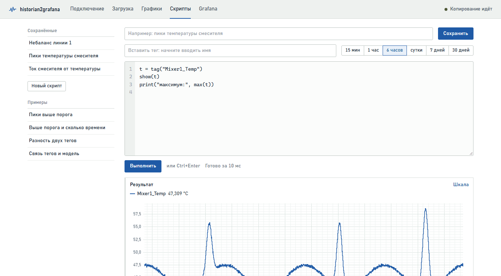
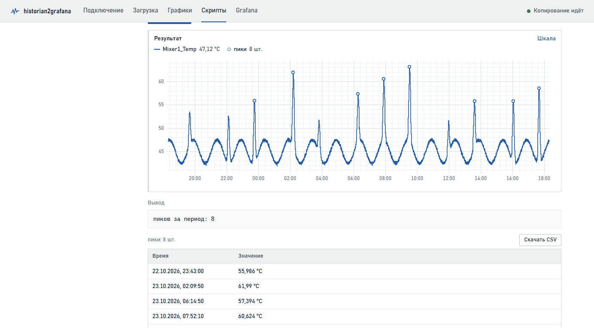
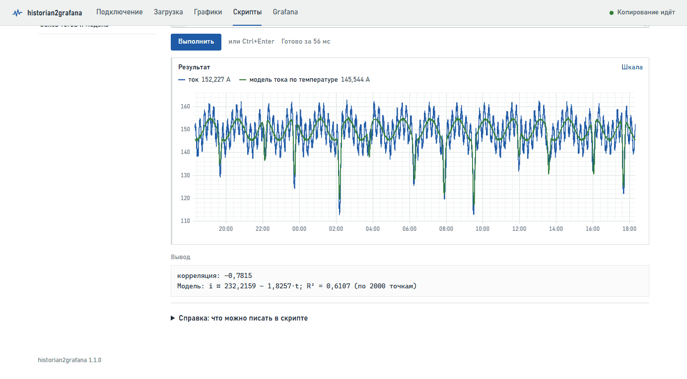
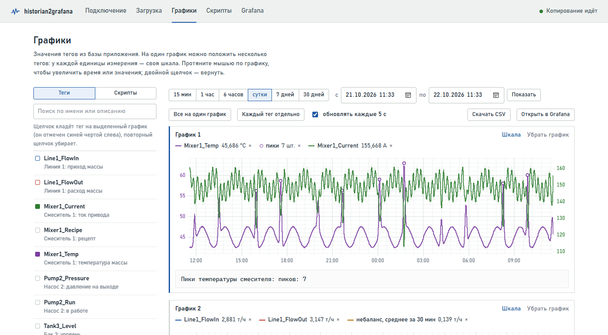
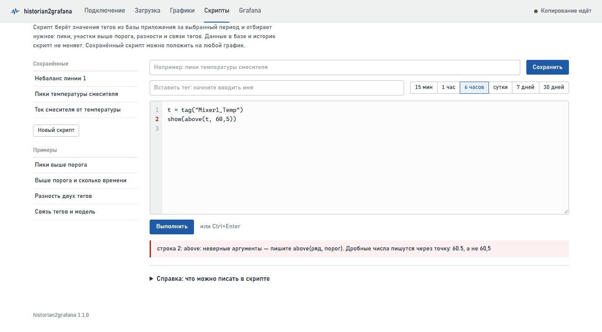

# Скрипты — руководство для начинающих

Скрипт — это несколько строк текста, которые говорят приложению, что сделать со значениями тегов: показать, отобрать, посчитать. Руководство написано для тех, кто никогда не программировал. Читайте по порядку: за 20–30 минут вы научитесь писать скрипты для повседневных задач. В конце — разбор ошибок и шпаргалка на одну страницу.

**Содержание**

- [1. Что такое скрипт и зачем он нужен](#1-что-такое-скрипт-и-зачем-он-нужен)
- [2. Где писать скрипты](#2-где-писать-скрипты)
- [3. Первый скрипт за две минуты](#3-первый-скрипт-за-две-минуты)
- [4. Пять правил записи](#4-пять-правил-записи)
- [5. Ряд, число и текст](#5-ряд-число-и-текст)
- [6. Готовые рецепты](#6-готовые-рецепты)
- [7. Условия: сравнения, «и», «или»](#7-условия-сравнения-и-или)
- [8. Интервалы времени](#8-интервалы-времени)
- [9. Справочник функций](#9-справочник-функций)
- [10. Результат скрипта на графиках](#10-результат-скрипта-на-графиках)
- [11. Ошибки и как их исправить](#11-ошибки-и-как-их-исправить)
- [12. Что скрипты не умеют](#12-что-скрипты-не-умеют)
- [13. Шпаргалка](#13-шпаргалка)

## 1. Что такое скрипт и зачем он нужен

Страница «Графики» показывает значения тегов как есть. Но часто нужно другое:

- «покажи только пики температуры»;
- «сколько времени температура была выше 60 градусов»;
- «насколько расход отстаёт от прихода»;
- «какая температура, пока насос работает»;
- «зависит ли ток привода от температуры массы».

На такие вопросы и отвечает скрипт. Вы пишете, что нужно, нажимаете **Выполнить** — и получаете график, числа и таблицу.

- **Скрипт работает с уже скопированными данными** — с тем, что лежит в базе приложения, за выбранный вами период.
- **Скрипт ничего не может испортить.** Он только читает: ни историк, ни база приложения не меняются. Самое плохое, что может случиться, — сообщение об ошибке.
- **Скрипт можно сохранить** и потом класть его результат на графики рядом с тегами.

> **Совет.** Не бойтесь экспериментировать. Меняйте числа, нажимайте «Выполнить» и смотрите, что получится, — так язык осваивается быстрее всего.

## 2. Где писать скрипты

Откройте в приложении страницу **Скрипты** (вкладка в шапке).



*Рис. 1. Страница «Скрипты»: слева список, справа редактор и результат*

| Часть страницы | Для чего |
|---|---|
| Сохранённые (слева) | Ваши сохранённые скрипты. Щелчок открывает скрипт и сразу выполняет его |
| Новый скрипт | Начать с чистого листа |
| Примеры (слева) | Готовые скрипты; в них сразу подставляется один из ваших тегов |
| Название, Сохранить, Удалить | Название скрипта — под ним он появится в списке и на графиках |
| Вставить тег | Поиск тега по имени или описанию: выбранный тег вставляется в текст скрипта там, где стоит курсор |
| Кнопки периода | За какой период брать значения: от 15 минут до 30 дней |
| Редактор | Здесь пишется скрипт. Слева — номера строк: по ним удобно искать ошибки |
| Выполнить (или Ctrl+Enter) | Выполнить скрипт и показать результат |
| Результат | Под редактором: график, блок «Вывод» с числами, таблицы найденных событий |
| Справка | Внизу страницы: все функции с короткими пояснениями |

Это руководство открывается и прямо из приложения — ссылкой «Руководство для начинающих» на странице «Скрипты».

## 3. Первый скрипт за две минуты

1. Откройте страницу **Скрипты** и нажмите **Новый скрипт**. В редакторе будут серые строки, начинающиеся со знака `#`. Это подсказки — приложение их пропускает. Их можно стереть.
2. Поставьте курсор на пустую строку. В поле **Вставить тег** начните вводить имя или описание тега, например «темп», и выберите тег в списке. В редакторе появится `tag("Mixer1_Temp")`.
3. Допишите в начало этой строки `t = `, чтобы получилось `t = tag("Mixer1_Temp")`.
4. На следующей строке напишите `show(t)`.
5. Выберите период, например **6 часов**, и нажмите **Выполнить**.

```python
t = tag("Mixer1_Temp")
show(t)
```

Под редактором появится график температуры. Что произошло: первая строка взяла значения тега за период и запомнила их под коротким именем `t`. Вторая строка показала `t` на графике.

Добавьте третью строку и снова нажмите **Выполнить**:

```python
print("максимум:", max(t))
```

Под графиком, в блоке **Вывод**, появится наибольшее значение температуры за период. Поздравляем — вы написали первый скрипт.

> **Примечание.** Имена тегов у вас будут свои. В примерах руководства — учебные теги: `Mixer1_Temp` (температура массы, °C), `Mixer1_Current` (ток привода, A), `Pump2_Run` (насос: 1 — работает, 0 — стоит), `Line1_FlowIn` и `Line1_FlowOut` (приход и расход массы, т/ч). Подставляйте вместо них свои — проще всего полем «Вставить тег».

## 4. Пять правил записи

### Правило 1. Одна строка — одно действие

Приложение выполняет строки по очереди, сверху вниз. Поэтому сначала берём тег, потом что-то с ним делаем. Каждая строка начинается с самого начала — без пробелов в начале строки.

### Правило 2. Имя = значение

Знак `=` запоминает результат под именем, чтобы не писать одно и то же много раз. Слева — имя, справа — что запомнить:

```python
t = tag("Mixer1_Temp")        # t — значения температуры
p = peaks(t, level=60)        # p — пики этой температуры
температура = tag("Mixer1_Temp")   # можно и по-русски
```

- Имя состоит из букв (латинских или русских), цифр и знака `_` и начинается с буквы: `t`, `temp2`, `расход_массы`.
- Большие и маленькие буквы различаются: `t` и `T` — разные имена.
- Имя нельзя называть так же, как функции: `tag`, `show`, `max` и другие из справочника.
- Имя можно использовать только в строках **ниже** той, где оно задано.

### Правило 3. Функция — это команда со скобками

Всё, что делает скрипт, делают функции: `tag(…)`, `show(…)`, `peaks(…)`. После имени функции — круглые скобки, внутри — что ей нужно (аргументы) через запятую:

```python
show(t)                                   # один аргумент
show(t, "температура")                    # два аргумента: что и с какой подписью
peaks(t, level=60, distance="10m")        # аргументы с именами
```

Аргументы без имени пишутся по порядку, как в справочнике: в `above(t, 60)` сначала ряд, потом порог. Аргументы с именем (`level=60`) пишутся после них, в любом порядке, и их можно пропускать. Функции можно вкладывать друг в друга: `count(peaks(t))` — число пиков.

### Правило 4. Текст — в кавычках, дробные числа — через точку

- Имена тегов, интервалы времени и подписи пишутся в **прямых** двойных кавычках: `"Mixer1_Temp"`, `"10m"`, `"пики"`. Кавычки «ёлочки» не подходят — так бывает, если текст скопирован из Word.
- Дробные числа пишутся **через точку**: `60.5`. Запятая разделяет аргументы, поэтому `above(t, 60,5)` приложение поймёт как три аргумента и сообщит об ошибке.

### Правило 5. После # — комментарий

Всё, что стоит после знака `#`, приложение пропускает. Пишите там пояснения для себя и коллег:

```python
show(t)   # температура за выбранный период
```

> **Совет.** Пробелы внутри строки ставьте где удобно: `peaks(t, level = 60)` и `peaks(t,level=60)` — одно и то же. Пустые строки тоже можно оставлять.

## 5. Ряд, число и текст

В скриптах встречаются три вида значений:

| Вид | Что это | Пример и как увидеть |
|---|---|---|
| Ряд | Значения во времени: тег или то, что из него получено (отобранные значения, пики, разность двух тегов) | `tag("Mixer1_Temp")`, `above(t, 60)`; на графике — `show(…)` |
| Число | Одно значение за весь период: максимум, среднее, количество | `max(t)`, `mean(t)`, `60`; в выводе — `print(…)` |
| Текст | Подпись, имя тега, интервал времени | `"пики"`, `"10m"`; всегда в кавычках |

### show и print — как увидеть результат

- `show(ряд, "подпись")` — показать ряд на графике под результатом. Подпись можно не писать: тогда в легенде будет имя тега или само выражение.
- `print("подпись:", число)` — вывести строку в блок «Вывод». В скобках через запятую — сколько угодно текстов и чисел.
- Строка без `=` и без `show`/`print` тоже показывает результат: ряд — на графике, число — в выводе. Так удобно быстро что-то проверить: напишите `max(t)` и нажмите «Выполнить».

### Арифметика

С рядами и числами работают обычные действия: `+`, `-`, `*`, `/` и скобки.

```python
a = tag("Line1_FlowIn")
b = tag("Line1_FlowOut")
show(a - b, "разность прихода и расхода")
show(a * 1000 / 3600, "приход, кг/с")
```

Если у двух тегов значения записаны в разные моменты, приложение само сопоставит их по времени: значение тега держится до следующего изменения — так же, как его записал историк.

## 6. Готовые рецепты

Каждый рецепт — законченный скрипт. Скопируйте его, замените имя тега на своё и выполните. Под кодом — что делает каждая строка.

### 6.1 Несколько тегов вместе

```python
t = tag("Mixer1_Temp")
i = tag("Mixer1_Current")
show(t, "температура")
show(i, "ток привода")
```

Оба тега появятся на одном графике. У разных единиц измерения (°C и A) — свои шкалы, слева и справа, цветом своего ряда.

### 6.2 Пики

```python
t = tag("Mixer1_Temp")
p = peaks(t, level=55, distance="30m")
show(t)
show(p, "пики")
print("пиков за период:", count(p))
```

- `peaks(t, …)` находит пики — точки, где значение выше соседних.
- `level=55` — только пики не ниже 55. Без него найдутся все, даже мелкие колебания.
- `distance="30m"` — не чаще одного пика за 30 минут: из близких пиков остаётся самый высокий.
- `count(p)` — сколько пиков найдено.



*Рис. 2. Пики отмечены кружками на линии тега; ниже — таблица со временем каждого пика*

Под графиком появится таблица: время и значение каждого пика. Кнопка **Скачать CSV** сохраняет её для Excel.

> **Совет.** Не знаете, какой уровень взять? Пусть его выберет скрипт: `level=quantile(t, 0.95)` — уровень, выше которого лежат только 5 % значений. Ещё один полезный аргумент — `prominence=3`: пик должен возвышаться над соседними впадинами хотя бы на 3 единицы, мелкая «рябь» отбрасывается. Впадины (минимумы) ищет `valleys(…)`.

### 6.3 Значения выше порога и сколько времени

```python
t = tag("Mixer1_Temp")
show(t)
show(const(55, t), "порог 55")
show(above(t, 55), "выше 55")
print("выше 55, часов:", duration(t > 55))
print("выше 55, минут:", duration(t > 55, "min"))
```

- `const(55, t)` — горизонтальная линия на уровне 55, на той же шкале, что и `t`.
- `above(t, 55)` — только значения выше 55; остальное время линия прерывается. Похожие функции: `below(t, 20)` — ниже порога, `between(t, 20, 55)` — в диапазоне.
- `t > 55` — условие «температура выше 55» (подробнее — раздел 7).
- `duration(условие)` — сколько времени условие выполнялось: в часах, а с `"min"` — в минутах.

### 6.4 Моменты, когда значение перешло порог

```python
t = tag("Mixer1_Temp")
up = crossings(t, 55, "up")
show(t)
show(up, "превышение 55")
print("сколько раз превышали 55:", count(up))
```

`crossings(t, 55, "up")` находит моменты, когда значение поднялось выше 55. Вместо `"up"` можно написать `"down"` — моменты, когда опустилось ниже, или `"both"` — и те и другие. Моменты появятся кружками на графике и таблицей под ним.

### 6.5 Значения одного тега, пока работает другой

```python
t = tag("Mixer1_Temp")
run = tag("Pump2_Run")
show(where(t, run == 1), "температура при работе насоса")
print("средняя при работе насоса:", mean(where(t, run == 1)))
print("насос работал, часов:", duration(run == 1))
```

- `run == 1` — условие «насос работает». Два знака равенства — это сравнение, один — запоминание имени.
- `where(t, условие)` — оставляет температуру только там, где условие выполняется.
- `mean(…)` — среднее значение за период.

### 6.6 Разность двух тегов (приход и расход)

```python
a = tag("Line1_FlowIn")
b = tag("Line1_FlowOut")
d = a - b
show(d, "разность")
show(smooth(d, "30m"), "среднее за 30 минут")
print("средняя разность, т/ч:", round(mean(d), 3))
```

- `a - b` — разность в каждый момент времени.
- `smooth(d, "30m")` — сглаживание: в каждой точке среднее за предыдущие 30 минут. Шум уходит, видна общая тенденция.
- `round(число, 3)` — округлить до трёх знаков после запятой.

### 6.7 Как быстро меняется значение

```python
t = tag("Mixer1_Temp")
v = rate(smooth(t, "5m"), "1m")
show(v, "скорость, °C в минуту")
print("самый быстрый рост, °C/мин:", max(v))
```

`rate(ряд, "1m")` — на сколько ряд меняется за минуту (с `"1h"` — за час). Сигнал сначала сглажен, иначе скорость будет «прыгать» от шума.

### 6.8 Сводка за период

```python
t = tag("Mixer1_Temp")
print("минимум:", min(t))
print("максимум:", max(t))
print("среднее:", round(mean(t), 1))
print("разброс:", round(std(t), 2))
print("значений за период:", count(t))
```

Числа появятся в блоке «Вывод». `std(t)` — разброс (среднеквадратичное отклонение): чем он больше, тем сильнее колеблется значение.

### 6.9 Связь двух тегов

```python
i = tag("Mixer1_Current")
t = tag("Mixer1_Temp")
print("корреляция:", corr(i, t))
show(i, "ток")
show(fit(i, t), "модель тока по температуре")
```



*Рис. 3. Ток привода и его модель по температуре; в выводе — корреляция и формула*

**Корреляция** `corr(a, b)` — число от −1 до 1, которое показывает, насколько согласованно меняются два тега:

- около **1** — растут и падают вместе;
- около **−1** — когда один растёт, другой падает (как здесь: масса горячее — она жиже, и ток привода меньше);
- около **0** — связи не видно.

**Модель** `fit(y, x)` подбирает формулу, как `y` зависит от `x`, и печатает её, например: «Модель: i ≈ 232,2 − 1,83·t; R² = 0,61». Читается так: при росте температуры на 1 °C ток падает на 1,8 А. **R²** — какую долю колебаний `y` объясняет формула: 1 — всё, 0 — ничего; 0,61 — больше половины. На график кладётся расчётный ряд — что ток «должен быть» по формуле; его удобно сравнить с фактическим. В модели может быть до пяти тегов: `fit(y, x1, x2, x3)`.

> **Важно.** Связь двух тегов ещё не означает, что один влияет на другой: оба могут зависеть от третьего. Корреляция и модель подсказывают, где искать, а выводы делает технолог.

### 6.10 Связь с запаздыванием

```python
a = tag("Line1_FlowIn")
b = tag("Line1_FlowOut")
print("без сдвига:", corr(a, b))
print("приход на 10 минут позже:", corr(shift(a, "10m"), b))
show(shift(a, "10m"), "приход, сдвинут на 10 минут")
show(b, "расход")
```

`shift(ряд, "10m")` сдвигает ряд на 10 минут позже (`"-10m"` — раньше). Если со сдвигом корреляция заметно выше, значит, расход повторяет приход примерно через 10 минут. Попробуйте несколько сдвигов и найдите тот, при котором корреляция наибольшая.

## 7. Условия: сравнения, «и», «или»

Сравнение ряда с числом или с другим рядом даёт **условие** — ряд из единиц (выполняется) и нулей (не выполняется). Условия нужны функциям `where` и `duration`.

| Запись | Значит | Пример |
|---|---|---|
| `>` | больше | `t > 55` |
| `<` | меньше | `t < 40` |
| `>=` | больше или равно | `t >= 55` |
| `<=` | меньше или равно | `t <= 40` |
| `==` | равно (два знака!) | `run == 1` |
| `!=` | не равно | `run != 1` |
| `and` | и: оба условия выполняются | `t > 55 and run == 1` |
| `or` | или: хотя бы одно | `t > 60 or t < 40` |
| `not` | не: условие не выполняется | `not run == 1` |

```python
t = tag("Mixer1_Temp")
run = tag("Pump2_Run")
print("горячо и насос работает, часов:", duration(t > 55 and run == 1))
show(where(t, t > 45 and t < 55), "от 45 до 55")
```

> **Важно.** Один знак `=` запоминает имя (`t = …`), два знака `==` сравнивают (`run == 1`). Это самая частая путаница.

## 8. Интервалы времени

Интервалы (окно сглаживания, расстояние между пиками, сдвиг) пишутся текстом в кавычках:

| Запись | Значит |
|---|---|
| `"30s"` | 30 секунд |
| `"5m"` или `"5мин"` | 5 минут |
| `"2h"` или `"2ч"` | 2 часа |
| `"1d"` или `"1сут"` | сутки |
| `"1.5h"` | полтора часа |
| `"-10m"` (только в `shift`) | на 10 минут раньше |

Число без кавычек считается в секундах: `smooth(t, 300)` — то же, что `smooth(t, "5m")`.

## 9. Справочник функций

В таблицах «ряд» — значения тега или то, что из них получено; «условие» — сравнение, например `t > 55`. Тот же список с короткими пояснениями есть на странице «Скрипты», в разделе «Справка».

### Взять данные и показать результат

| Функция | Что делает | Пример |
|---|---|---|
| `tag("имя")` | Значения тега за выбранный период | `t = tag("Mixer1_Temp")` |
| `show(ряд, "подпись")` | Показать ряд на графике | `show(t, "температура")` |
| `print(…)` | Вывести тексты и числа в блок «Вывод» | `print("максимум:", max(t))` |

### Отобрать значения

| Функция | Что делает | Пример |
|---|---|---|
| `above(ряд, порог)` | Только значения выше порога | `above(t, 55)` |
| `below(ряд, порог)` | Только значения ниже порога | `below(t, 40)` |
| `between(ряд, от, до)` | Только значения в диапазоне | `between(t, 45, 55)` |
| `where(ряд, условие)` | Значения, пока условие выполняется | `where(t, run == 1)` |

### Найти события

| Функция | Что делает | Пример |
|---|---|---|
| `peaks(ряд, level=…, distance=…, prominence=…)` | Пики (максимумы) | `peaks(t, level=55, distance="30m")` |
| `valleys(ряд, level=…, distance=…, prominence=…)` | Впадины (минимумы); level — не выше уровня | `valleys(t, level=40)` |
| `crossings(ряд, порог, "up")` | Моменты перехода порога: "up", "down" или "both" | `crossings(t, 55, "both")` |

### Преобразовать ряд

| Функция | Что делает | Пример |
|---|---|---|
| `smooth(ряд, "5m")` | Сгладить: среднее за окно | `smooth(t, "10m")` |
| `rate(ряд, "1m")` | Скорость изменения за минуту (час…) | `rate(t, "1h")` |
| `shift(ряд, "10m")` | Сдвинуть по времени | `shift(a, "-5m")` |
| `resample(ряд, "1h", "mean")` | На ровный шаг: "mean" — среднее, "min", "max", "last" | `resample(t, "1h", "max")` — максимум за каждый час |
| `const(число, ряд)` | Горизонтальная линия на шкале ряда | `const(55, t)` |
| `abs(…)`, `round(…, 2)` | Модуль; округление | `abs(a - b)`, `round(mean(t), 1)` |

### Посчитать число за период

| Функция | Что даёт | Пример |
|---|---|---|
| `mean(ряд)` | Среднее (с учётом того, сколько времени держалось каждое значение) | `mean(t)` |
| `min(ряд)`, `max(ряд)` | Наименьшее и наибольшее значение | `max(t)` |
| `std(ряд)` | Разброс значений | `std(t)` |
| `quantile(ряд, 0.95)` | Уровень, выше которого только 5 % значений | `quantile(t, 0.9)` |
| `count(ряд)` | Сколько значений (или событий) | `count(peaks(t))` |
| `sum(ряд)` | Сумма значений | `sum(p)` |
| `last(ряд)` | Последнее значение | `last(t)` |
| `duration(условие, "h")` | Сколько времени условие выполнялось: "h" — часы, "min", "s" | `duration(t > 55, "min")` |

### Связь тегов

| Функция | Что даёт | Пример |
|---|---|---|
| `corr(ряд1, ряд2)` | Корреляция: от −1 до 1 | `corr(i, t)` |
| `fit(y, x1, x2, …)` | Линейная модель: печатает формулу и R², даёт расчётный ряд | `show(fit(i, t), "модель")` |

## 10. Результат скрипта на графиках

1. На странице «Скрипты» введите **Название** и нажмите **Сохранить**.
2. Откройте страницу **Графики**, слева выберите вкладку **Скрипты**.
3. Щёлкните по своему скрипту — его результат ляжет на выделенный график рядом с тегами. Пики рисуются кружками на линии своего тега, текст из `print` — под графиком.



*Рис. 4. Результат скрипта «Пики температуры» на графике рядом с тегами*

Период берётся с графика. При включённом автообновлении результат скрипта пересчитывается раз в 30 секунд. Если скрипт потом изменить и сохранить, графики покажут уже новый результат.

> **Примечание.** Пока скрипт не сохранён, приложение помнит черновик в браузере и предупредит, если вы уходите со страницы с несохранёнными изменениями.

## 11. Ошибки и как их исправить

Если в скрипте ошибка, под редактором появится красная рамка с сообщением, а номер строки с ошибкой слева станет красным. Исправьте строку и снова нажмите **Выполнить**.



*Рис. 5. Ошибка в строке 2: дробное число записано через запятую*

| Сообщение (начало) | Что случилось и что делать |
|---|---|
| не закрыта кавычка | У текста нет второй кавычки: `tag("Mixer1_Temp)` → `tag("Mixer1_Temp")` |
| не закрыта скобка / лишняя закрывающая скобка | Посчитайте скобки в строке: сколько открыто, столько и закрыто |
| пропущена запятая между аргументами | `peaks(t level=60)` → `peaks(t, level=60)` |
| … Дробные числа пишутся через точку | `60,5` → `60.5` |
| кавычки пишутся прямые | Текст скопирован из Word: замените «…» на "…" |
| вместо минуса стоит тире | Замените «–» на обычный минус `-` |
| число слито с буквами | Интервал без кавычек: `smooth(t, 5m)` → `smooth(t, "5m")` |
| имя «…» не задано | Имя не задано в строках выше, или в нём опечатка, или перепутаны большие и маленькие буквы. Приложение подскажет похожее имя |
| … Если это имя тега — пишите tag("…") | Имя тега написано без `tag` и кавычек: `show(Mixer1_Temp)` → `show(tag("Mixer1_Temp"))` |
| нет функции «…» — может быть, …? | Опечатка в названии функции: `peak` → `peaks` |
| тега «…» нет в базе приложения | Имя тега с ошибкой или тег не копируется. Вставляйте имя полем «Вставить тег»; список тегов — на странице «Загрузка» |
| тег «…» строковый | Текстовые теги (рецепт, номер партии) скрипты не считают |
| …: первый аргумент — ряд | Перепутан порядок: `above(55, t)` → `above(t, 55)` |
| …: неверные аргументы — пишите … | Лишний или пропущенный аргумент. Правильная запись — в самом сообщении |
| лишний отступ в начале строки | Уберите пробелы в начале строки |
| условий if нет / циклов в скриптах нет | Эти конструкции здесь не нужны: отбирайте функциями `where`, `above`, считайте `duration`, `count` |
| обращения через точку нет | Пишите `mean(t)`, а не `t.mean()` |
| … больше 500 000 значений — сократите период | У тега очень частые значения — выберите период короче |
| выполняется дольше 30 с | Сократите период или упростите скрипт |

Сообщение «Скрипт выполнен, но ничего не показал» — не ошибка: в скрипте нет `show` и `print`. Добавьте их.

## 12. Что скрипты не умеют

- Менять данные: скрипт только читает базу приложения и ничего не пишет ни в неё, ни в историк.
- Брать данные, которых нет в базе приложения: только теги, которые копируются, и только за скопированный период.
- Считать текстовые теги (рецепт, номер партии).
- Циклы, условия `if`, свои функции, импорт библиотек — язык намеренно простой и безопасный. Всё нужное делают функции из справочника.
- Ограничения одного запуска: до 20 разных тегов, до 500 000 значений одного тега, до 30 секунд расчёта и до 20 рядов на графике.

Для тех, кто знает Python: синтаксис тот же (присваивания, арифметика, сравнения, вызовы функций), но выполняет его не интерпретатор Python, а само приложение — только разрешённые конструкции.

## 13. Шпаргалка

```text
# взять тег и показать
t = tag("Mixer1_Temp")
show(t, "температура")

# отбор
above(t, 55)   below(t, 40)   between(t, 45, 55)   where(t, run == 1)

# события
peaks(t, level=55, distance="30m")   valleys(t, level=40)   crossings(t, 55, "up")

# преобразования
smooth(t, "5m")   rate(t, "1m")   shift(t, "10m")   resample(t, "1h", "max")   const(55, t)

# числа за период — в print
mean(t)  min(t)  max(t)  std(t)  quantile(t, 0.95)  count(p)  duration(t > 55, "min")

# связь тегов
corr(a, b)   fit(y, x1, x2)

# условия:  >  <  >=  <=  ==  !=  and  or  not
# интервалы: "30s"  "5m"  "2h"  "1d"
# текст — в прямых кавычках "…", дробные числа — через точку 60.5, комментарий — после #
```
