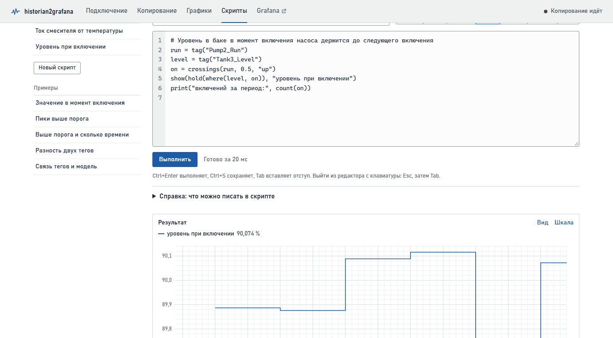

# Скрипты — руководство для начинающих

Скрипт — это несколько строк текста, в которых вы говорите приложению, что сделать со значениями тегов: показать, отобрать или посчитать. Руководство написано для тех, кто никогда не программировал. Если читать по порядку и пробовать примеры, за полчаса можно научиться писать скрипты для повседневных задач. В конце есть разбор ошибок и шпаргалка на одну страницу.

**Содержание**

- [1. Что такое скрипт и зачем он нужен](#1-что-такое-скрипт-и-зачем-он-нужен)
- [2. Где писать скрипты](#2-где-писать-скрипты)
- [3. Первый скрипт за две минуты](#3-первый-скрипт-за-две-минуты)
- [4. Пять правил записи](#4-пять-правил-записи)
- [5. Ряд, число и текст](#5-ряд-число-и-текст)
- [6. Готовые рецепты](#6-готовые-рецепты)
- [7. Условия: сравнения, «и», «или»](#7-условия-сравнения-и-или)
- [8. Интервалы времени](#8-интервалы-времени)
- [9. Справочник функций](#9-справочник-функций)
- [10. Результат скрипта на графиках](#10-результат-скрипта-на-графиках)
- [11. Ошибки и как их исправить](#11-ошибки-и-как-их-исправить)
- [12. Что скрипты не умеют](#12-что-скрипты-не-умеют)
- [13. Шпаргалка](#13-шпаргалка)

## 1. Что такое скрипт и зачем он нужен

Страница «Графики» показывает значения тегов как есть. А вопросы на производстве обычно другие:

- «покажи только пики температуры»;
- «сколько времени температура была выше 60 градусов»;
- «насколько расход отстаёт от прихода»;
- «какая была температура, пока работал насос»;
- «зависит ли ток привода от температуры массы».

На такие вопросы и отвечает скрипт. Вы пишете, что нужно, нажимаете «Выполнить» и получаете график, числа и таблицу.

Работает скрипт с данными, которые уже скопированы в базу приложения, за выбранный вами период. Испортить он ничего не может: он только читает, и ни историк, ни база от него не меняются. Худшее, что может случиться, — сообщение об ошибке. Готовый скрипт можно сохранить и потом класть его результат на графики рядом с тегами.

> **Совет.** Не бойтесь экспериментировать. Меняйте числа, нажимайте «Выполнить» и смотрите, что выйдет. Так язык осваивается быстрее, чем по любому справочнику.

## 2. Где писать скрипты

Откройте в приложении страницу «Скрипты», это вкладка в шапке.


*Рис. 1. Страница «Скрипты»: слева список, справа редактор и результат*

| Часть страницы | Для чего |
|---|---|
| Сохранённые (слева) | Ваши сохранённые скрипты. Щелчок открывает скрипт и сразу его выполняет |
| Новый скрипт | Начать с чистого листа |
| Примеры (слева) | Готовые скрипты, в них сразу подставляется один из ваших тегов |
| Название, «Сохранить», «Удалить» | Под этим названием скрипт появится в списке и на графиках |
| Вставить тег | Поиск тега по имени или описанию. Выбранный тег вставляется в текст скрипта там, где стоит курсор |
| Кнопки периода | За какой период брать значения: от 15 минут до 30 дней или свой. Период общий со страницей «Графики» |
| Редактор | Здесь пишется скрипт. Слева номера строк, по ним удобно искать ошибки |
| «Выполнить» (или Ctrl+Enter) | Выполнить скрипт и показать результат |
| Результат | Под редактором: график, блок «Вывод» с числами и таблицы найденных событий |
| Справка | Под кнопкой «Выполнить», все функции с короткими пояснениями |

Это руководство открывается и прямо из приложения, ссылкой «руководство для начинающих» на странице «Скрипты».

## 3. Первый скрипт за две минуты

1. Откройте страницу «Скрипты» и нажмите «Новый скрипт». В редакторе появятся строки, начинающиеся со знака `#`. Это подсказки, приложение их пропускает, так что их можно стереть.
2. Поставьте курсор на пустую строку. В поле «Вставить тег» начните вводить имя или описание тега, например «темп», и выберите тег в списке. В редакторе появится `tag("Mixer1_Temp")`.
3. Допишите в начало этой строки `t = `, чтобы получилось `t = tag("Mixer1_Temp")`.
4. На следующей строке напишите `show(t)`.
5. Выберите период, например «6 часов», и нажмите «Выполнить».

```python
t = tag("Mixer1_Temp")
show(t)
```

Под редактором появится график температуры. Первая строка взяла значения тега за период и запомнила их под коротким именем `t`, вторая показала `t` на графике.

Теперь добавьте третью строку и снова нажмите «Выполнить»:

```python
print("максимум:", max(t))
```

Под графиком, в блоке «Вывод», появится наибольшее значение температуры за период. Вот и весь первый скрипт: три строки, и уже есть ответ на вопрос.

> **Примечание.** Имена тегов у вас будут свои. В примерах руководства используются учебные теги: `Mixer1_Temp` (температура массы, °C), `Mixer1_Current` (ток привода, A), `Pump2_Run` (насос: 1 значит работает, 0 стоит), `Line1_FlowIn` и `Line1_FlowOut` (приход и расход массы, т/ч). Подставляйте вместо них свои, проще всего через поле «Вставить тег».

## 4. Пять правил записи

### Правило 1. Одна строка — одно действие

Приложение выполняет строки по очереди, сверху вниз. Поэтому сначала берём тег, а потом что-то с ним делаем. Каждая строка начинается с самого начала, без пробелов впереди.

### Правило 2. Имя = значение

Знак `=` запоминает результат под именем, чтобы не писать одно и то же много раз. Слева стоит имя, справа то, что нужно запомнить:

```python
t = tag("Mixer1_Temp")        # t — значения температуры
p = peaks(t, level=60)        # p — пики этой температуры
температура = tag("Mixer1_Temp")   # можно и по-русски
```

Имя состоит из букв (латинских или русских), цифр и знака `_` и начинается с буквы: `t`, `temp2`, `расход_массы`. Большие и маленькие буквы различаются, `t` и `T` для приложения разные имена. Называть имя так же, как функцию (`tag`, `show`, `max` и другие из справочника), нельзя. И пользоваться именем можно только в строках ниже той, где оно задано.

### Правило 3. Функция — это команда со скобками

Всю работу в скрипте делают функции: `tag(…)`, `show(…)`, `peaks(…)`. После имени функции идут круглые скобки, а в них через запятую то, что ей нужно. Это называется аргументами:

```python
show(t)                                   # один аргумент
show(t, "температура")                    # два аргумента: что и с какой подписью
peaks(t, level=60, distance="10m")        # аргументы с именами
```

Аргументы без имени пишутся по порядку, как в справочнике: в `above(t, 60)` сначала ряд, потом порог. Аргументы с именем, вроде `level=60`, ставятся после них в любом порядке, и их можно пропускать. Функции вкладываются друг в друга: `count(peaks(t))` даёт число пиков.

### Правило 4. Текст в кавычках, дробные числа через точку

Имена тегов, интервалы времени и подписи пишутся в прямых двойных кавычках: `"Mixer1_Temp"`, `"10m"`, `"пики"`. Кавычки-ёлочки не подойдут. Обычно они появляются, когда текст скопирован из Word.

Дробные числа пишутся через точку: `60.5`. Запятая в скрипте разделяет аргументы, поэтому `above(t, 60,5)` приложение поймёт как три аргумента и сообщит об ошибке.

### Правило 5. После # идёт комментарий

Всё, что стоит после знака `#`, приложение пропускает. Там удобно писать пояснения для себя и коллег:

```python
show(t)   # температура за выбранный период
```

> **Совет.** Пробелы внутри строки ставьте как удобно: `peaks(t, level = 60)` и `peaks(t,level=60)` означают одно и то же. Пустые строки между командами тоже не мешают.

## 5. Ряд, число и текст

В скриптах встречаются три вида значений:

| Вид | Что это | Пример и как увидеть |
|---|---|---|
| Ряд | Значения во времени: тег или то, что из него получено (отобранные значения, пики, разность двух тегов) | `tag("Mixer1_Temp")`, `above(t, 60)`. На график выводится через `show(…)` |
| Число | Одно значение за весь период: максимум, среднее, количество | `max(t)`, `mean(t)`, `60`. В вывод попадает через `print(…)` |
| Текст | Подпись, имя тега, интервал времени | `"пики"`, `"10m"`, всегда в кавычках |

### show и print: как увидеть результат

`show(ряд, "подпись")` показывает ряд на графике под редактором. Подпись можно не писать, тогда в легенде будет имя тега или само выражение.

`print("подпись:", число)` выводит строку в блок «Вывод». В скобках через запятую можно перечислить сколько угодно текстов и чисел.

Вывод пишет числа по-русски: с запятой, например `3,4132`. В самом скрипте дробная часть отделяется точкой, поэтому число из вывода, перенесённое в скрипт, нужно поправить: `3.4132`. Знак минус «−» из вывода переносить можно, приложение его понимает.

Строка без `=`, `show` и `print` тоже показывает результат: ряд на графике, число в выводе. Это удобно для быстрой проверки. Напишите `max(t)`, нажмите «Выполнить», и всё.

### Арифметика

С рядами и числами работают обычные действия: `+`, `-`, `*`, `/` и скобки.

```python
a = tag("Line1_FlowIn")
b = tag("Line1_FlowOut")
show(a - b, "разность прихода и расхода")
show(a * 1000 / 3600, "приход, кг/с")
```

Значения двух тегов обычно записаны в разные моменты, но сопоставлять их вручную не нужно. Приложение сделает это само: значение тега держится до следующего изменения, ровно так, как его записал историк.

## 6. Готовые рецепты

Каждый рецепт — законченный скрипт. Скопируйте его, замените имя тега на своё и выполните. Под кодом объяснено, что делает каждая строка.

### 6.1 Несколько тегов вместе

```python
t = tag("Mixer1_Temp")
i = tag("Mixer1_Current")
show(t, "температура")
show(i, "ток привода")
```

Оба тега окажутся на одном графике. Единицы у них разные (°C и A), поэтому шкал будет две, слева и справа, каждая цветом своего ряда.

### 6.2 Пики

```python
t = tag("Mixer1_Temp")
p = peaks(t, level=55, distance="30m")
show(t)
show(p, "пики")
print("пиков за период:", count(p))
```

`peaks(t, …)` ищет пики, то есть точки, где значение выше соседних. `level=55` оставляет только пики не ниже 55, без него найдутся все, вплоть до мелких колебаний. `distance="30m"` значит «не чаще одного пика за 30 минут»: из близких пиков остаётся самый высокий. `count(p)` считает, сколько пиков нашлось.


*Рис. 2. Пики отмечены кружками на линии тега, ниже таблица со временем каждого пика*

Под графиком появится таблица со временем и значением каждого пика. Кнопка «Скачать CSV» сохраняет её для Excel.

> **Совет.** Не знаете, какой уровень взять? Пусть его выберет скрипт: `level=quantile(t, 0.95)` даёт уровень, выше которого лежат только 5 % значений. Пригодится и аргумент `prominence=3`: тогда пик должен возвышаться над соседними впадинами хотя бы на 3 единицы, и мелкая «рябь» отбрасывается. Впадины, то есть минимумы, ищет `valleys(…)`.

### 6.3 Значения выше порога и сколько времени

```python
t = tag("Mixer1_Temp")
show(t)
show(const(55, t), "порог 55")
show(above(t, 55), "выше 55")
print("выше 55, часов:", duration(t > 55))
print("выше 55, минут:", duration(t > 55, "min"))
```

`const(55, t)` рисует горизонтальную линию на уровне 55 на той же шкале, что и `t`. `above(t, 55)` оставляет только значения выше 55, в остальное время линия прерывается. Есть и похожие функции: `below(t, 20)` для значений ниже порога и `between(t, 20, 55)` для диапазона.

`t > 55` — это условие «температура выше 55» (про условия подробно в разделе 7). `duration(условие)` считает, сколько времени оно выполнялось: по умолчанию в часах, а с `"min"` в минутах.

### 6.4 Моменты, когда значение перешло порог

```python
t = tag("Mixer1_Temp")
up = crossings(t, 55, "up")
show(t)
show(up, "превышение 55")
print("сколько раз превышали 55:", count(up))
```

`crossings(t, 55, "up")` находит моменты, когда значение поднялось выше 55. Если вместо `"up"` написать `"down"`, найдутся моменты, когда оно опустилось ниже, а `"both"` найдёт и те, и другие. На графике моменты будут кружками, а под графиком таблицей.

### 6.5 Значения одного тега, пока работает другой

```python
t = tag("Mixer1_Temp")
run = tag("Pump2_Run")
show(where(t, run == 1), "температура при работе насоса")
print("средняя при работе насоса:", mean(where(t, run == 1)))
print("насос работал, часов:", duration(run == 1))
```

`run == 1` означает «насос работает». Обратите внимание на два знака равенства: так записывается сравнение, а один знак запоминает имя. `where(t, условие)` оставляет температуру только там, где условие выполняется, а `mean(…)` считает среднее за период.

### 6.6 Разность двух тегов (приход и расход)

```python
a = tag("Line1_FlowIn")
b = tag("Line1_FlowOut")
d = a - b
show(d, "разность")
show(smooth(d, "30m"), "среднее за 30 минут")
print("средняя разность, т/ч:", round(mean(d), 3))
```

`a - b` даёт разность в каждый момент времени. `smooth(d, "30m")` её сглаживает: в каждой точке берётся среднее за предыдущие 30 минут, шум уходит, и видна общая тенденция. `round(число, 3)` округляет до трёх знаков после запятой.

### 6.7 Как быстро меняется значение

```python
t = tag("Mixer1_Temp")
v = rate(smooth(t, "5m"), "1m")
show(v, "скорость, °C в минуту")
print("самый быстрый рост, °C/мин:", max(v))
```

`rate(ряд, "1m")` показывает, на сколько ряд меняется за минуту (с `"1h"` за час). Сигнал здесь сначала сглажен, иначе скорость будет прыгать от каждого шума.

### 6.8 Сводка за период

```python
t = tag("Mixer1_Temp")
print("минимум:", min(t))
print("максимум:", max(t))
print("среднее:", round(mean(t), 1))
print("разброс:", round(std(t), 2))
print("значений за период:", count(t))
```

Все числа появятся в блоке «Вывод». `std(t)` — разброс, или среднеквадратичное отклонение: чем он больше, тем сильнее колеблется значение.

### 6.9 Связь двух тегов

```python
i = tag("Mixer1_Current")
t = tag("Mixer1_Temp")
print("корреляция:", corr(i, t))
show(i, "ток")
show(fit(i, t), "модель тока по температуре")
```


*Рис. 3. Ток привода и его модель по температуре, в выводе корреляция и формула*

Корреляция `corr(a, b)` — число от −1 до 1. Оно показывает, насколько согласованно меняются два тега. Если оно около 1, теги растут и падают вместе. Около −1, когда один растёт, другой падает. Здесь как раз так: горячая масса жиже, и приводу её мешать легче. Около 0 связи не видно.

Модель `fit(y, x)` подбирает формулу, как `y` зависит от `x`, и печатает её, например: «Модель: i ≈ 232,2 − 1,83·t; R² = 0,61». Читается это так: если температура выросла на 1 °C, ток упал примерно на 1,8 А. R² показывает, какую долю колебаний `y` объясняет формула: 1 значит всю, 0 никакую, а 0,61 чуть больше половины. На график ложится расчётный ряд, то есть каким ток «должен быть» по формуле, и его удобно сравнить с фактическим. В модель можно взять до пяти тегов: `fit(y, x1, x2, x3)`.

> **Важно.** Связь двух тегов ещё не значит, что один влияет на другой: оба могут зависеть от чего-то третьего. Корреляция и модель подсказывают, куда смотреть, а выводы всё равно делает технолог.

### 6.10 Связь с запаздыванием

```python
a = tag("Line1_FlowIn")
b = tag("Line1_FlowOut")
print("без сдвига:", corr(a, b))
print("приход на 10 минут позже:", corr(shift(a, "10m"), b))
show(shift(a, "10m"), "приход, сдвинут на 10 минут")
show(b, "расход")
```

`shift(ряд, "10m")` сдвигает ряд на 10 минут позже, а `"-10m"` на 10 минут раньше. Если со сдвигом корреляция заметно выше, значит, расход повторяет приход примерно через 10 минут. Попробуйте несколько сдвигов и найдите тот, при котором корреляция больше всего. Так можно оценить, сколько масса идёт по линии.

### 6.11 Значение другого тега в момент переключения

Когда насос включается, запомним уровень в баке и будем держать его до следующего включения:

```python
run = tag("Pump2_Run")
level = tag("Tank3_Level")
on = crossings(run, 0.5, "up")
show(hold(where(level, on)), "уровень при включении")
print("включений за период:", count(on))
```



*Рис. 4. Уровень в момент включения насоса держится до следующего включения*

`crossings(run, 0.5, "up")` находит моменты перехода из 0 в 1, а `where(level, on)` берёт уровень именно в эти моменты. Получаются отдельные события, и на графике они были бы точками. Функция `hold` держит каждое значение до следующего, и получается ступенчатый ряд. Без `hold` те же ступени можно выбрать мышью: ссылка «Вид» над графиком, вместо «точки» выбрать «ступени». Разница в том, что ряд из `hold` можно использовать дальше, например вычесть из него другой тег, а «Вид» меняет только рисунок.

## 7. Условия: сравнения, «и», «или»

Если сравнить ряд с числом или с другим рядом, получится условие. Это тоже ряд, только из единиц (условие выполняется) и нулей (не выполняется). Условия нужны функциям `where` и `duration`.

| Запись | Значит | Пример |
|---|---|---|
| `>` | больше | `t > 55` |
| `<` | меньше | `t < 40` |
| `>=` | больше или равно | `t >= 55` |
| `<=` | меньше или равно | `t <= 40` |
| `==` | равно (два знака!) | `run == 1` |
| `!=` | не равно | `run != 1` |
| `and` | и: выполняются оба условия | `t > 55 and run == 1` |
| `or` | или: выполняется хотя бы одно | `t > 60 or t < 40` |
| `not` | не: условие не выполняется | `not run == 1` |

```python
t = tag("Mixer1_Temp")
run = tag("Pump2_Run")
print("горячо и насос работает, часов:", duration(t > 55 and run == 1))
show(where(t, t > 45 and t < 55), "от 45 до 55")
```

> **Важно.** Один знак `=` запоминает имя (`t = …`), два знака `==` сравнивают (`run == 1`). На этом спотыкаются чаще всего, так что, если скрипт ведёт себя странно, первым делом проверьте знаки равенства.

## 8. Интервалы времени

Окно сглаживания, расстояние между пиками или сдвиг пишутся текстом в кавычках:

| Запись | Значит |
|---|---|
| `"30s"` | 30 секунд |
| `"5m"` или `"5мин"` | 5 минут |
| `"2h"` или `"2ч"` | 2 часа |
| `"1d"` или `"1сут"` | сутки |
| `"1.5h"` | полтора часа |
| `"-10m"` (только в `shift`) | на 10 минут раньше |

Число без кавычек приложение считает в секундах, так что `smooth(t, 300)` и `smooth(t, "5m")` дают одно и то же. Но с буквами нагляднее.

## 9. Справочник функций

В таблицах «ряд» означает значения тега или то, что из них получено, а «условие» — сравнение вроде `t > 55`. Тот же список с короткими пояснениями есть на странице «Скрипты», в разделе «Справка».

### Взять данные и показать результат

| Функция | Что делает | Пример |
|---|---|---|
| `tag("имя")` | Значения тега за выбранный период | `t = tag("Mixer1_Temp")` |
| `show(ряд, "подпись")` | Показывает ряд на графике | `show(t, "температура")` |
| `print(…)` | Выводит тексты и числа в блок «Вывод» | `print("максимум:", max(t))` |

### Отобрать значения

| Функция | Что делает | Пример |
|---|---|---|
| `above(ряд, порог)` | Оставляет только значения выше порога | `above(t, 55)` |
| `below(ряд, порог)` | Оставляет только значения ниже порога | `below(t, 40)` |
| `between(ряд, от, до)` | Оставляет только значения в диапазоне | `between(t, 45, 55)` |
| `where(ряд, условие)` | Оставляет значения, пока условие выполняется | `where(t, run == 1)` |

### Найти события

| Функция | Что делает | Пример |
|---|---|---|
| `peaks(ряд, level=…, distance=…, prominence=…)` | Находит пики (максимумы) | `peaks(t, level=55, distance="30m")` |
| `valleys(ряд, level=…, distance=…, prominence=…)` | Находит впадины (минимумы). Здесь level означает «не выше уровня» | `valleys(t, level=40)` |
| `crossings(ряд, порог, "up")` | Находит моменты перехода порога: "up", "down" или "both" | `crossings(t, 55, "both")` |

### Преобразовать ряд

| Функция | Что делает | Пример |
|---|---|---|
| `smooth(ряд, "5m")` | Сглаживает: среднее за окно | `smooth(t, "10m")` |
| `rate(ряд, "1m")` | Скорость изменения за минуту (час и т. д.) | `rate(t, "1h")` |
| `shift(ряд, "10m")` | Сдвигает по времени | `shift(a, "-5m")` |
| `resample(ряд, "1h", "mean")` | Приводит к ровному шагу: "mean" для среднего, а также "min", "max", "last" | `resample(t, "1h", "max")`: максимум за каждый час |
| `hold(ряд)` | Держит каждое значение до следующего: из событий получаются ступени | `hold(where(t, on))` |
| `const(число, ряд)` | Горизонтальная линия на шкале ряда | `const(55, t)` |
| `abs(…)`, `round(…, 2)` | Модуль и округление | `abs(a - b)`, `round(mean(t), 1)` |

### Посчитать число за период

| Функция | Что даёт | Пример |
|---|---|---|
| `mean(ряд)` | Среднее, с учётом того, сколько времени держалось каждое значение | `mean(t)` |
| `min(ряд)`, `max(ряд)` | Наименьшее и наибольшее значение | `max(t)` |
| `std(ряд)` | Разброс значений | `std(t)` |
| `quantile(ряд, 0.95)` | Уровень, выше которого только 5 % значений | `quantile(t, 0.9)` |
| `count(ряд)` | Сколько значений (или событий) | `count(peaks(t))` |
| `sum(ряд)` | Сумма значений | `sum(p)` |
| `last(ряд)` | Последнее значение | `last(t)` |
| `duration(условие, "h")` | Сколько времени условие выполнялось: "h" в часах, "min" в минутах, "s" в секундах | `duration(t > 55, "min")` |

### Связь тегов

| Функция | Что даёт | Пример |
|---|---|---|
| `corr(ряд1, ряд2)` | Корреляцию, от −1 до 1 | `corr(i, t)` |
| `fit(y, x1, x2, …)` | Линейную модель: печатает формулу и R² и возвращает расчётный ряд | `show(fit(i, t), "модель")` |

## 10. Результат скрипта на графиках

1. На странице «Скрипты» введите название и нажмите «Сохранить».
2. Откройте страницу «Графики» и слева выберите вкладку «Скрипты».
3. Щёлкните по своему скрипту, и его результат ляжет на график рядом с тегами. Пики рисуются кружками на линии своего тега, а текст из `print` выводится под графиком.


*Рис. 5. Результат скрипта «Пики температуры» на графике рядом с тегами*

Период скрипт берёт с графика. Если включено автообновление, результат пересчитывается раз в 30 секунд. Изменили и сохранили скрипт — графики покажут уже новый результат.

Как рисовать результат, настраивается ссылкой «Вид» над графиком: ступени, линия или точки, толщина, цвет и заливка. Сохранённый скрипт виден и в Grafana: на дашборде «Теги историка» в поле «Скрипты», а в новой панели в списке источника «Теги и скрипты». Кнопка «Сохранить как дашборд» на странице «Графики» переносит в Grafana графики целиком, вместе с их видом. Подробно об этом написано в инструкции, в разделах 9.5 и 10.

> **Примечание.** Пока скрипт не сохранён, приложение держит черновик в браузере. Если попытаться уйти со страницы с несохранёнными изменениями, оно переспросит.

## 11. Ошибки и как их исправить

Если в скрипте ошибка, под редактором появится красная рамка с сообщением, а номер строки с ошибкой слева станет красным. Исправьте строку и снова нажмите «Выполнить». Сообщения написаны так, чтобы по ним было понятно, что поправить, и часто в них уже есть подсказка.


*Рис. 6. Ошибка в строке 2: дробное число записано через запятую*

| Начало сообщения | Что случилось и что делать |
|---|---|
| не закрыта кавычка | У текста нет второй кавычки: `tag("Mixer1_Temp)` надо исправить на `tag("Mixer1_Temp")` |
| не закрыта скобка / лишняя закрывающая скобка | Посчитайте скобки в строке: сколько открыто, столько должно быть и закрыто |
| пропущена запятая между аргументами | `peaks(t level=60)` → `peaks(t, level=60)` |
| … Дробные числа пишутся через точку | `60,5` → `60.5` |
| кавычки пишутся прямые | Текст скопирован из Word. Замените «…» на "…" |
| вместо минуса стоит тире | Замените «–» на обычный минус `-` |
| число слито с буквами | Интервал написан без кавычек: `smooth(t, 5m)` → `smooth(t, "5m")` |
| имя «…» не задано | Имя не задано в строках выше, в нём опечатка или перепутаны большие и маленькие буквы. Похожее имя приложение подскажет само |
| … Если это имя тега — пишите tag("…") | Имя тега написано без `tag` и кавычек: `show(Mixer1_Temp)` → `show(tag("Mixer1_Temp"))` |
| нет функции «…» — может быть, …? | Опечатка в названии функции: `peak` → `peaks` |
| тега «…» нет в базе приложения | В имени тега ошибка, или тег не копируется. Вставляйте имя через поле «Вставить тег». Список тегов есть на странице «Копирование» |
| тег «…» строковый | Текстовые теги (рецепт, номер партии) скрипты не считают |
| …: первый аргумент — ряд | Перепутан порядок: `above(55, t)` → `above(t, 55)` |
| …: неверные аргументы — пишите … | Лишний или пропущенный аргумент. Правильная запись приведена в самом сообщении |
| лишний отступ в начале строки | Уберите пробелы в начале строки |
| условий if нет / циклов в скриптах нет | Эти конструкции здесь не нужны. Отбирайте функциями `where` и `above`, считайте через `duration` и `count` |
| обращения через точку нет | Пишите `mean(t)`, а не `t.mean()` |
| … больше 500 000 значений — сократите период | У тега очень частые значения, выберите период короче |
| выполняется дольше 30 с | Сократите период или упростите скрипт |

«Скрипт выполнен, но ничего не показал» — не ошибка. Просто в скрипте нет ни `show`, ни `print`, добавьте их.

## 12. Что скрипты не умеют

Менять данные они не могут: скрипт только читает базу приложения и ничего не пишет ни в неё, ни в историк. Брать данные, которых в базе нет, тоже не могут, то есть работают только с копируемыми тегами и только за скопированный период. Текстовые теги, вроде рецепта или номера партии, скрипты не считают.

Циклов, условий `if`, своих функций и импорта библиотек в языке нет. Это сделано нарочно, чтобы язык оставался простым и безопасным, а всё нужное делают функции из справочника.

У одного запуска есть пределы: до 20 разных тегов, до 500 000 значений одного тега, до 30 секунд расчёта и до 20 рядов на графике.

Если вы знаете Python: синтаксис тот же (присваивания, арифметика, сравнения, вызовы функций), но выполняет его не интерпретатор Python, а само приложение, и только разрешённые конструкции.

## 13. Шпаргалка

```text
# взять тег и показать
t = tag("Mixer1_Temp")
show(t, "температура")

# отбор
above(t, 55)   below(t, 40)   between(t, 45, 55)   where(t, run == 1)

# события
peaks(t, level=55, distance="30m")   valleys(t, level=40)   crossings(t, 55, "up")

# преобразования
smooth(t, "5m")   rate(t, "1m")   shift(t, "10m")   resample(t, "1h", "max")   const(55, t)

# числа за период (выводить через print)
mean(t)  min(t)  max(t)  std(t)  quantile(t, 0.95)  count(p)  duration(t > 55, "min")

# связь тегов
corr(a, b)   fit(y, x1, x2)

# условия:  >  <  >=  <=  ==  !=  and  or  not
# интервалы: "30s"  "5m"  "2h"  "1d"
# текст в прямых кавычках "…", дробные числа через точку 60.5, комментарий после #
```
